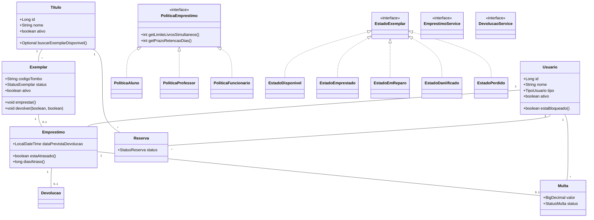

# Design — Gerenciador de Biblioteca

**Projeto:** Gerenciador de Biblioteca  
**Módulo:** Empréstimo, Devolução e Reserva de Exemplares  
**Base:** `specs/spec.md` (Spec-Driven Development)  
**Versão:** 1.0  
**Status:** Em elaboração (pré-código)

---

## 1. Visão Geral da Arquitetura

A solução segue uma **arquitetura em camadas (Layered Architecture)** inspirada em **Hexagonal Architecture / Ports & Adapters**, de forma a manter o domínio puro (sem dependências de frameworks externos) e isolar as preocupações de infraestrutura (persistência, notificação, API).

### Camadas

| Camada | Responsabilidade | Exemplo de pacote |
|--------|-----------------|-------------------|
| `domain` | Entidades, value objects, exceções de negócio, interfaces de serviço (ports) e regras de negócio | `org.example.biblioteca.domain` |
| `application` | Casos de uso, orquestração de serviços, DTOs de entrada/saída | `org.example.biblioteca.application` |
| `infrastructure` | Repositórios (JPA), adaptadores de notificação, configuração | `org.example.biblioteca.infrastructure` |
| `presentation` | REST controllers, CLI, exceções mapeadas para HTTP | `org.example.biblioteca.presentation` |

**Pacote base sugerido:** `org.example.biblioteca`  
**Linguagem:** Java 17+  
**Build:** Maven (`pom.xml` existente na raiz)  
**Transação:** `@Transactional` nas operações de empréstimo/devolução para garantir atomicidade (exigência NF01 do spec.md).

---

## 2. Modelagem de Classes e Interfaces do Domínio

Abaixo estão as entidades e interfaces principais, com seus atributos, métodos e relacionamentos, derivados diretamente do `spec.md`.

### 2.1 Enumerados de suporte

```java
public enum TipoUsuario {
    ALUNO, PROFESSOR, FUNCIONARIO
}

public enum StatusExemplar {
    DISPONIVEL, EMPRESTADO, EM_REPARO, DANIFICADO, PERDIDO
}

public enum StatusReserva {
    AGUARDANDO, NOTIFICADA, CONCLUIDA, CANCELADA, EXPIRADA
}

public enum StatusMulta {
    PENDENTE, PAGA, CANCELADA
}
```

### 2.2 Usuário

Entidade que representa uma pessoa cadastrada no sistema (aluno, professor ou funcionário).

```java
public class Usuario {
    private Long id;
    private String nome;
    private String email;
    private String matricula; // único
    private TipoUsuario tipo;
    private boolean ativo; // cadastro ativo/inativo (RN: validação obrigatória)
    private List<Emprestimo> emprestimosAtivos;
    private List<Multa> multasPendentes;
    private List<Reserva> reservas;

    // Construtores, getters, setters, equals/hashCode

    public boolean estaBloqueado() {
        return !ativo || !multasPendentes.isEmpty()
            || emprestimosAtivos.stream().anyMatch(Emprestimo::estaAtrasado);
    }

    public int quantidadeEmprestimosAtivos() {
        return emprestimosAtivos == null ? 0 : emprestimosAtivos.size();
    }
}
```

**Regras de negócio refletidas:**
- `ativo` deve ser `true` para qualquer operação (RF10).
- Usuário bloqueado (livro atrasado ou multa pendente) não pode emprestar (RN06).

---

### 2.3 Título

Obra bibliográfica. Agrupa múltiplos exemplares.

```java
public class Titulo {
    private Long id;
    private String nome; // ex: "Dom Casmurro"
    private String autor;
    private String isbn;
    private boolean ativo;
    private List<Exemplar> exemplares;

    public Optional<Exemplar> buscarExemplarDisponivel() {
        return exemplares.stream()
            .filter(e -> e.estaDisponivel() && e.isAtivo())
            .findFirst();
    }

    public boolean possuiExemplarDisponivel() {
        return buscarExemplarDisponivel().isPresent();
    }
}
```

---

### 2.4 Exemplar

Cópia física de um título, identificada por **código de tombo único**. Possui máquina de estados (padrão State, seção 3.2).

```java
public class Exemplar {
    private Long id;
    private String codigoTombo; // único (RF04)
    private Titulo titulo;
    private StatusExemplar status; // DISPONIVEL, EMPRESTADO, EM_REPARO, DANIFICADO, PERDIDO
    private boolean ativo; // cadastro ativo/inativo (RF10)
    private Emprestimo emprestimoAtivo; // empréstimo vigente, se houver

    public boolean estaDisponivel() {
        return status == StatusExemplar.DISPONIVEL && ativo;
    }

    public boolean estaIndisponivelPorEstado() {
        return status == StatusExemplar.EM_REPARO
            || status == StatusExemplar.DANIFICADO
            || status == StatusExemplar.PERDIDO;
    }

    // Transições delegadas ao EstadoExemplar (State)
    public void emprestar() { estado.executarEmprestimo(this); }
    public void devolver(boolean danificado, boolean perdido) { estado.executarDevolucao(this, danificado, perdido); }
    public void enviarParaReparo() { estado.executarEnviarReparo(this); }
    public void darBaixa() { estado.executarBaixa(this); }
}
```

**Regras de negócio refletidas:**
- Só pode ser emprestado se `DISPONIVEL` (RN04).
- `EM_REPARO`, `DANIFICADO`, `PERDIDO` indisponíveis para empréstimo (RN04, spec 3.2).

---

### 2.5 Empréstimo

Registro da retirada de um exemplar por um usuário.

```java
public class Emprestimo {
    private Long id;
    private Usuario usuario;
    private Exemplar exemplar;
    private String operador; // bibliotecário ou "autoatendimento" (auditoria, NF02)
    private LocalDateTime dataEmprestimo;
    private LocalDateTime dataPrevistaDevolucao; // conforme tipo do usuário (RF02)
    private LocalDateTime dataRealDevolucao;
    private boolean ativo; // empréstimo não encerrado
    private Multa multa; // opcional, gerada na devolução com atraso

    public boolean estaAtrasado() {
        return ativo && dataPrevistaDevolucao != null
            && LocalDateTime.now().isAfter(dataPrevistaDevolucao);
    }

    public long diasAtraso() {
        if (!estaAtrasado()) return 0;
        return ChronoUnit.DAYS.between(dataPrevistaDevolucao, LocalDateTime.now());
    }
}
```

---

### 2.6 Devolução

Registro da entrega de um exemplar emprestado (pode gerar multa).

```java
public class Devolucao {
    private Long id;
    private Emprestimo emprestimo;
    private LocalDateTime dataDevolucao;
    private boolean exemplarDanificado;
    private boolean exemplarPerdido;
    private Multa multaGerada; // null se não houver atraso
}
```

---

### 2.7 Reserva

Fila de espera por um título quando todos os exemplares estão emprestados (RN05).

```java
public class Reserva {
    private Long id;
    private Usuario usuario;
    private Titulo titulo;
    private LocalDateTime dataReserva;
    private StatusReserva status;
    private LocalDateTime dataNotificacao; // quando notificado da disponibilidade
    private LocalDateTime dataExpiracao; // 3 dias corridos após dataNotificacao (spec.md, seção 3.6)
}
```

---

### 2.8 Multa

Valor cobrado por atraso ou taxa de reposição por dano/perda.

**Parâmetros consolidados (spec.md, seção 3.6):**
- Multa por atraso: **R$ 2,00 por dia** (`valor = diasAtraso * 2,00`).
- Taxa de reposição (dano/perda): **R$ 50,00 por exemplar**.

```java
public class Multa {
    private Long id;
    private Usuario usuario;
    private Emprestimo emprestimo; // origem (pode ser null para taxa de reposição avulsa)
    private BigDecimal valor; // ex: diasAtraso * 2,00 ou 50,00 (taxa de reposição)
    private StatusMulta status; // PENDENTE, PAGA, CANCELADA
    private LocalDateTime dataVencimento;
    private String descricao; // ex: "Atraso de 3 dias = R$ 6,00" ou "Taxa de reposição - exemplar perdido = R$ 50,00"
}
```

---

## 3. Padrões de Projeto (Design Patterns)

### 3.1 Strategy — Cálculo de prazo e limite por tipo de usuário (RN01, RN02, RN03)

**Intenção:** Encapsular as regras de limite de livros simultâneos e prazo de retenção de cada tipo de usuário, permitindo trocar o algoritmo em tempo de execução sem alterar o serviço de empréstimo. Aplica Open/Closed Principle: novo tipo de usuário não exige modificar classes existentes.

#### Interface da estratégia

```java
public interface PoliticaEmprestimo {
    int getLimiteLivrosSimultaneos();
    int getPrazoRetencaoDias();
    boolean podeEmprestar(Usuario usuario); // validações específicas da política
}
```

#### Implementações concretas

| Classe | Tipo de usuário | Limite | Prazo | RN |
|--------|----------------|--------|-------|----|
| `PoliticaAluno` | ALUNO | 3 | 14 dias | RN01 |
| `PoliticaProfessor` | PROFESSOR | 5 | 30 dias | RN02 |
| `PoliticaFuncionario` | FUNCIONARIO | 3 | 14 dias | RN03 |

Exemplo:

```java
public class PoliticaAluno implements PoliticaEmprestimo {
    @Override public int getLimiteLivrosSimultaneos() { return 3; }
    @Override public int getPrazoRetencaoDias() { return 14; }
    @Override public boolean podeEmprestar(Usuario usuario) {
        return usuario.estaAtivo() && !usuario.estaBloqueado();
    }
}
```

#### Contexto (uso no serviço)

```java
public class ContextoPoliticaEmprestimo {
    private PoliticaEmprestimo politica;

    public void setPolitica(TipoUsuario tipoUsuario) {
        this.politica = PoliticaFactory.criar(tipoUsuario);
    }

    public int prazoDias() { return politica.getPrazoRetencaoDias(); }
    public int limite() { return politica.getLimiteLivrosSimultaneos(); }
    public boolean valida(Usuario usuario) { return politica.podeEmprestar(usuario); }
}
```

---

### 3.2 State — Gerenciamento das transições de status do Exemplar

**Intenção:** Encapsular o comportamento associado a cada status do exemplar (`DISPONIVEL`, `EMPRESTADO`, `EM_REPARO`, `DANIFICADO`, `PERDIDO`) e permitir que o exemplar altere seu comportamento conforme seu estado interno, evitando blocos `if/else` ou `switch` espalhados pelo código.

#### Interface do estado

```java
public interface EstadoExemplar {
    void executarEmprestimo(Exemplar exemplar);
    void executarDevolucao(Exemplar exemplar, boolean danificado, boolean perdido);
    void executarEnviarReparo(Exemplar exemplar);
    void executarBaixa(Exemplar exemplar);
    boolean podeEmprestar();
}
```

#### Estados concretos

| Estado | Emprestar | Devolver (ok) | Devolver (danificado/perdido) | Enviar Reparo | Baixa |
|--------|-----------|---------------|-------------------------------|---------------|-------|
| `EstadoDisponivel` → `EMPRESTADO` | ✅ | N/A | N/A | → `EM_REPARO` | ❌ |
| `EstadoEmprestado` → `DISPONIVEL` | ❌ (já emprestado) | → `DISPONIVEL` | → `DANIFICADO`/`PERDIDO` + baixa | ❌ | ❌ |
| `EstadoEmReparo` | ❌ | ❌ | ❌ | N/A | ❌ |
| `EstadoDaniificado` | ❌ | ❌ | ❌ | ❌ | ✅ (baixa) |
| `EstadoPerdido` | ❌ | ❌ | ❌ | ❌ | ✅ (baixa) |

Exemplo de transição:

```java
public class EstadoEmprestado implements EstadoExemplar {
    @Override public void executarDevolucao(Exemplar exemplar, boolean danificado, boolean perdido) {
        if (perdido) {
            exemplar.setStatus(new EstadoPerdido());
            exemplar.darBaixa(); // taxa de reposição (RN07)
        } else if (danificado) {
            exemplar.setStatus(new EstadoDaniificado());
            exemplar.darBaixa();
        } else {
            exemplar.setStatus(new EstadoDisponivel());
        }
    }
    // outros métodos lançam IllegalStateException ouOperacaoNaoPermitidaException
}
```

**Regras de negócio refletidas:**
- Exemplar `DANIFICADO`/`PERDIDO` recebe baixa e não volta ao acervo disponível (RN07, spec 3.4).
- `EM_REPARO` indisponível para empréstimo (RN04).

---

### 3.3 Factory — Criação de estratégias e entidades

**Intenção:** Centralizar a criação de objetos de domínio e estratégias, desacoplando o cliente das classes concretas e facilitando a manutenção quando novos tipos de usuário, status ou entidades forem adicionados.

#### Factory de políticas (Strategy)

```java
public class PoliticaFactory {
    public static PoliticaEmprestimo criar(TipoUsuario tipo) {
        return switch (tipo) {
            case ALUNO -> new PoliticaAluno();
            case PROFESSOR -> new PoliticaProfessor();
            case FUNCIONARIO -> new PoliticaFuncionario();
        };
    }
}
```

#### Factory de estados (State)

```java
public class EstadoExemplarFactory {
    public static EstadoExemplar criar(StatusExemplar status) {
        return switch (status) {
            case DISPONIVEL -> new EstadoDisponivel();
            case EMPRESTADO -> new EstadoEmprestado();
            case EM_REPARO -> new EstadoEmReparo();
            case DANIFICADO -> new EstadoDaniificado();
            case PERDIDO -> new EstadoPerdido();
        };
    }
}
```

#### Factory de entidades de domínio

```java
public class DominioFactory {
    public static Usuario criarUsuario(String nome, String email, String matricula, TipoUsuario tipo) { ... }
    public static Titulo criarTitulo(String nome, String autor, String isbn) { ... }
    public static Exemplar criarExemplar(String codigoTombo, Titulo titulo) { ... }
    public static Emprestimo criarEmprestimo(Usuario usuario, Exemplar exemplar,
                                            String operador, int prazoDias) { ... }
    public static Reserva criarReserva(Usuario usuario, Titulo titulo) { ... }
    public static Multa criarMulta(Usuario usuario, BigDecimal valor, String descricao) { ... }
}
```

---

## 4. Interface de Serviços e Exceções de Negócio

### 4.1 EmprestimoService

Interface (port) responsável pelo caso de uso **CU01 — Realizar empréstimo de exemplar**.

```java
public interface EmprestimoService {

    /**
     * Realiza o empréstimo de um exemplar para um usuário.
     *
     * @param usuarioId   ID do usuário solicitante
     * @param tituloId    ID do título desejado (ou exemplarId, se informado)
     * @param exemplarId  ID do exemplar específico (opcional)
     * @param operador    Identificador do operador (bibliotecário ou "autoatendimento")
     * @return DTO com dados do empréstimo criado
     * @throws UsuarioBloqueadoException   se usuário inativo, com atraso ou multa pendente
     * @throws UsuarioNaoEncontradoException
     * @throws TituloNaoEncontradoException
     * @throws ExemplarNaoEncontradoException
     * @throws ExemplarIndisponivelException se não há exemplar DISPONIVEL
     * @throws LimiteEmprestimoAtingidoException se o usuário atingiu o limite de seu tipo
     * @throws RegraNegocioException para outras violações de RN
     */
    EmprestimoDTO emprestar(Long usuarioId, Long tituloId, Long exemplarId, String operador)
            throws UsuarioBloqueadoException, ExemplarIndisponivelException,
                   LimiteEmprestimoAtingidoException, RegraNegocioException;

    /**
     * Consulta se há exemplar disponível para um título.
     */
    boolean existeExemplarDisponivel(Long tituloId);

    /**
     * Lista empréstimos ativos de um usuário.
     */
    List<EmprestimoDTO> listarEmprestimosAtivos(Long usuarioId);
}
```

### 4.2 DevolucaoService

Interface (port) responsável pelo caso de uso **CU02 — Realizar devolução de exemplar**.

```java
public interface DevolucaoService {

    /**
     * Registra a devolução de um exemplar.
     *
     * @param emprestimoId ID do empréstimo ativo
     * @param operador     Identificador do operador
     * @param danificado   se o exemplar está danificado
     * @param perdido      se o exemplar está perdido
     * @return DTO com dados da devolução e multa gerada, se houver
     * @throws EmprestimoNaoEncontradoException
     * @throws ExemplarIndisponivelException se o exemplar não está emprestado
     * @throws RegraNegocioException para outras violações
     */
    DevolucaoDTO devolver(Long emprestimoId, String operador,
                          boolean danificado, boolean perdido)
            throws EmprestimoNaoEncontradoException, RegraNegocioException;

    /**
     * Calcula a multa por atraso sem efetivar a devolução (consulta).
     */
    MultaDTO calcularMultaAtraso(Long emprestimoId);
}
```

---

### 4.3 Exceções de Negócio

Todas herdam de uma exceção base de domínio, permitindo tratamento padronizado na camada de apresentação.

```java
public class RegraNegocioException extends Exception {
    public RegraNegocioException(String mensagem) { super(mensagem); }
}

public class UsuarioBloqueadoException extends RegraNegocioException {
    public UsuarioBloqueadoException(String mensagem) { super(mensagem); }
}

public class ExemplarIndisponivelException extends RegraNegocioException {
    public ExemplarIndisponivelException(String mensagem) { super(mensagem); }
}

public class LimiteEmprestimoAtingidoException extends RegraNegocioException {
    public LimiteEmprestimoAtingidoException(String mensagem) { super(mensagem); }
}

public class UsuarioNaoEncontradoException extends RegraNegocioException { ... }
public class TituloNaoEncontradoException extends RegraNegocioException { ... }
public class ExemplarNaoEncontradoException extends RegraNegocioException { ... }
public class EmprestimoNaoEncontradoException extends RegraNegocioException { ... }
public class ReservaNaoEncontradaException extends RegraNegocioException { ... }
```

**Mapeamento sugerido na camada de apresentação (REST):**

| Exceção | HTTP Status |
|---------|-------------|
| `UsuarioBloqueadoException` | 403 Forbidden |
| `ExemplarIndisponivelException` | 409 Conflict |
| `LimiteEmprestimoAtingidoException` | 409 Conflict |
| `*NaoEncontradoException` | 404 Not Found |
| `RegraNegocioException` | 400 Bad Request |

---

## 5. Fluxos de Casos de Uso (resumo da especificação)

### CU01 — Empréstimo
1. Recebe solicitação (usuário, título/exemplar, operador).
2. Valida usuário ativo e não bloqueado → senão `UsuarioBloqueadoException`.
3. Valida limite de empréstimos via `PoliticaEmprestimo` (Strategy) → senão `LimiteEmprestimoAtingidoException`.
4. Busca exemplar `DISPONIVEL` do título → senão `ExemplarIndisponivelException` e oferece `Reserva`.
5. Cria `Emprestimo` com `dataPrevistaDevolucao` = hoje + prazo da Strategy.
6. Altera status do exemplar para `EMPRESTADO` (State).
7. Persiste de forma atômica (transação).

### CU02 — Devolução
1. Localiza empréstimo ativo do exemplar/usuário.
2. Calcula atraso: se `dataReal > dataPrevista`, gera `Multa` com **R$ 2,00 por dia de atraso** (`valor = diasAtraso * 2,00`).
3. Usuário fica bloqueado até quitação da multa (RN06).
4. Atualiza status do exemplar via State:
   - OK → `DISPONIVEL`
   - Danificado/perdido → `DANIFICADO`/`PERDIDO`, **taxa de reposição de R$ 50,00**, baixa do exemplar (RN07).
5. Se houver fila de reserva, notifica o primeiro da fila (`Reserva` → `NOTIFICADA`). A reserva expira em **3 dias corridos** após a notificação (spec.md, seção 3.6).

### CU03 — Consulta de reserva
- Consulta posição na fila por título.
- Notificação quando exemplar fica disponível.

---

## 6. Diagrama de Classes Resumido (Mermaid)



---

## 7. Requisitos Não Funcionais (NF) — impacto no design

| NF | Descrição | Como é atendido |
|----|-----------|-----------------|
| NF01 | Atomicidade de empréstimo/devolução | `@Transactional` nos serviços de aplicação |
| NF02 | Auditoria (operador, data/hora, exemplar) | Campos `operador`, `dataEmprestimo`, `dataDevolucao` nas entidades |
| NF03 | Performance na consulta de disponibilidade | Índice composto no banco: `(titulo_id, status, ativo)` |

---

## 8. Próximos passos

1. Revisar e aprovar este `design.md` com o stakeholder.
2. Implementar entidades de domínio e exceções.
3. Implementar factories e estratégias (Strategy/State/Factory).
4. Implementar camada de serviço (`EmprestimoService`, `DevolucaoService`) e validações.
5. Implementar camada de apresentação e persistência.
